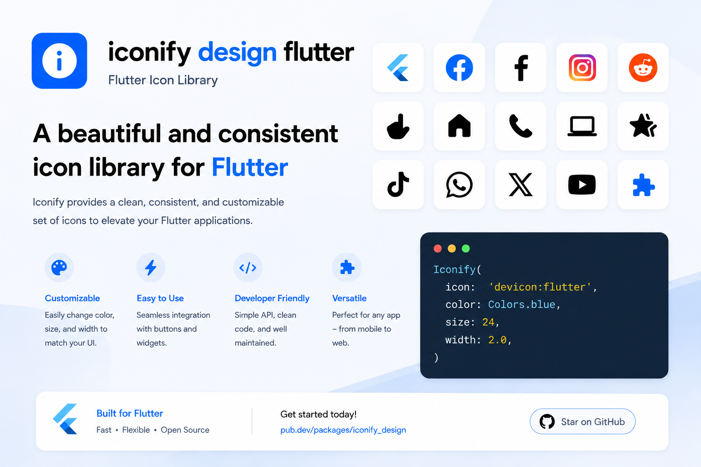

<!--
This README describes the package. If you publish this package to pub.dev,
this README's contents appear on the landing page for your package.

For information about how to write a good package README, see the guide for
[writing package pages](https://dart.dev/guides/libraries/writing-package-pages).

For general information about developing packages, see the Dart guide for
[creating packages](https://dart.dev/guides/libraries/create-library-packages)
and the Flutter guide for
[developing packages and plugins](https://flutter.dev/developing-packages).
-->

# Iconify Design

A Flutter package that allows you to use icons from the [Iconify.design](https://iconify.design/) API with ease. This package provides a widget called IconifyIcon that takes an icon string and optionally allows you to specify the size, color, placeholder, and error widget of the icon.



### Installation
Add the following to your `pubspec.yaml` file:

```yaml
dependencies:
  iconify_design: ^1.0.3
```
Then run:
```sh
flutter pub get
```
### Usage

```dart
import 'package:iconify_design/iconify_design.dart';
import 'package:flutter/material.dart';
```
### Example
Here is an example of how to use the `IconifyIcon` widget:

```dart
import 'package:flutter/material.dart';
import 'package:iconify_design/iconify_design.dart';

void main() {
  runApp(MyApp());
}

class MyApp extends StatelessWidget {
  @override
  Widget build(BuildContext context) {
    return MaterialApp(
      home: Scaffold(
        appBar: AppBar(
          title: Text('Iconify Flutter Example'),
        ),
        body: Center(
          child: IconifyIcon(
            icon: 'mdi:home',
            size: 48.0,
            color: Colors.blue,
            placeholder: CircularProgressIndicator(),
            errorWidget: Icon(
              Icons.error_outline,
              color: Colors.red,
            ),
          ),
        ),
      ),
    );
  }
}
```

### Parameters
The `IconifyIcon` widget has the following parameters:
1. **icon**: The icon string (e.g., **'mdi:home'**, **'iconoir:fill-color-solid'**, etc.).
2. **size (optional)**: The size of the icon. Default is 24.0.
3. **color (optional)**: The color of the icon. Default is **Black**. Passing `null` also falls back to **Black**.
4. **placeholder (optional)**: The widget to display while the icon is loading. Default is a small circular progress indicator.
5. **errorWidget (optional)**: The widget to display when the icon cannot be loaded. Default is an empty widget.

### Custom Placeholder and Error Widget

You can customize the loading and error states:

```dart
IconifyIcon(
  icon: 'mdi:home',
  placeholder: const SizedBox(
    width: 24,
    height: 24,
    child: CircularProgressIndicator(strokeWidth: 2),
  ),
  errorWidget: const Icon(
    Icons.error_outline,
    color: Colors.red,
  ),
)
```

### Custom API URL and timeout

By default, icons are fetched from `https://api.iconify.design/` with a 30-second receive timeout. To override these settings, run `flutter pub add dio` in your app and assign `IconifyClientService.dio` before `runApp`.

```dart
import 'package:dio/dio.dart';
import 'package:flutter/material.dart';
import 'package:iconify_design/iconify_design.dart';

void main() {
  IconifyClientService.dio = Dio(
    BaseOptions(
      baseUrl: 'https://iconify.yourdomain.com/',
      receiveTimeout: const Duration(seconds: 60),
    ),
  );

  runApp(
    const MaterialApp(home: Center(child: IconifyIcon(icon: 'mdi:home'))),
  );
}
```

### Custom Cache Backend

Icons are cached in `SharedPreferences` by default. To use a different backend, assign both `cacheGet` and `cacheSet` before `runApp`. Both callbacks can run synchronously or return a `Future`. Return `null` from `cacheGet` when a key is missing.

```dart
import 'package:flutter/material.dart';
import 'package:iconify_design/iconify_design.dart';

void main() {
  // in-memory cache (icons are cleared when app restarts)
  final Map<String, String> iconCache = {};
  IconifyClientService.cacheGet = (key) => iconCache[key];
  IconifyClientService.cacheSet = (key, data) => iconCache[key] = data;

  runApp(
    const MaterialApp(home: Center(child: IconifyIcon(icon: 'mdi:home'))),
  );
}
```

### Contribution

Feel free to open issues or submit pull requests to help improve this package.

### License

This project is licensed under the MIT License - see the [LICENSE](https://github.com/ThisIsMonta/iconify_design_flutter/blob/main/LICENSE) file for details.

### Support

Don't forget to support (if you can).

[](https://buymeacoffee.com/monta.sghaier)

### Maintainers

* [Montassar sghaier](https://github.com/ThisIsMonta)
